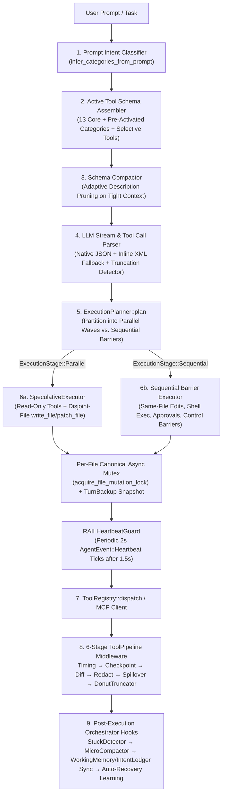

# `minicode` Tool System & Autonomous Orchestrator Architecture (`v0.3.94`)

> **Canonical Reference for `minicode` Tool Management, Dynamic Schema Loading, Wave-Based Speculative Execution, Safety Pipelines, and Self-Healing Orchestration.**

---

## 1. Executive Summary & Design Philosophy

`minicode` implements a **Zero-Command Autonomous Tool Architecture**. Unlike legacy coding agents that either dump 200+ JSON schemas into every LLM prompt (causing severe token bloat and tool-selection degradation) or force human users to manually toggle toolsets via `/commands`, `minicode`'s Orchestrator ([`AgentLoop`](../src/agent/loop.rs)) manages the entire tool lifecycle **100% automatically**:

- **Total Native Tool Inventory**: **`207` built-in domain tools** across **`13` specialized categories** + **`1` dynamic meta-tool (`activate_tools`)** = **`208` native tool schemas**, plus unlimited external **MCP (`mcp_<server>_<tool>`)** tools.
- **13-Tool Core Baseline (~85% Prompt Token Savings)**: Every turn in `Dynamic` mode starts with only **13 core tools** (`read_file`, `patch_file`, `write_file`, `replace_in_files`, `exec_cmd`, `sandbox_exec`, `grep_search`, `locate_symbol`, `create_plan`, `read_plan`, `update_progress`, `archive_plan`, `ask_user`) plus `activate_tools`.
- **Zero-Friction Lazy Activation**: Tools are activated automatically via:
  1. **Zero-Latency Prompt Intent Detection** ([`infer_categories_from_prompt`](../src/tools/category.rs)) before Turn Step 1.
  2. **Selective Individual Tool Search & Activation** (`activate_tools` with `select:<tool1>,<tool2>`, comma-separated categories, or keyword search `query`).
  3. **Direct Lazy Tool Auto-Sync & Near-Miss Fuzzy Recovery** ([`AgentLoop::execute_turn`](../src/agent/loop.rs)) when the model calls an unactivated or slightly misspelled tool name directly.

---

## 2. End-to-End Tool Execution Architecture

---

## 3. Complete Tool Inventory (`207` Built-In Tools + `activate_tools` + MCP)

### 3.1 Always-Loaded Core Baseline (`13` Domain Tools + `1` Meta-Tool)
Defined in [`get_core_schemas()`](../src/tools/category.rs):

| Group | Core Tools Always Active in `Dynamic` Mode |
| :--- | :--- |
| **Filesystem (4)** | `read_file`, `patch_file`, `write_file`, `replace_in_files` |
| **Execution (2)** | `exec_cmd`, `sandbox_exec` |
| **Search (2)** | `grep_search`, `locate_symbol` |
| **Planning & Memory (4)** | `create_plan`, `read_plan`, `update_progress`, `archive_plan` |
| **Human Inquiry (1)** | `ask_user` |
| **Dynamic Meta-Tool (1)** | `activate_tools` |

### 3.2 Complete 13-Category Breakdown (`207` Built-In Tools)

| # | Category (`ToolCategory`) | Registry Module | Count | Complete Tool Roster |
| :- | :--- | :--- | :---: | :--- |
| 1 | **`files`** (`Files`) | [`fs_tools.rs`](../src/tools/registry/fs_tools.rs) | **10** | `read_file`, `patch_file`, `repair_patch`, `replace_in_files`, `write_file`, `ast_replace_node`, `begin_transaction`, `commit_transaction`, `rollback_transaction`, `get_transaction_status` |
| 2 | **`exec`** (`Exec`) | [`exec_tools.rs`](../src/tools/registry/exec_tools.rs) | **2** | `exec_cmd`, `sandbox_exec` |
| 3 | **`search`** (`Search`) | [`search_tools.rs`](../src/tools/registry/search_tools.rs) | **10** | `grep_search`, `file_search`, `locate_symbol`, `hybrid_search`, `semantic_search`, `search_symbols_semantic`, `ast_query`, `ast_extract_symbol`, `ast_diff`, `locate_fault` |
| 4 | **`git`** (`Git`) | [`git_tools.rs`](../src/tools/registry/git_tools.rs) | **20** | `git_init`, `git_status`, `git_diff`, `git_commit`, `git_push`, `git_pull`, `git_log`, `git_conflicts`, `git_review`, `create_pr`, `github_issue_view`, `github_issue_list`, `github_issue_create`, `github_pr_view`, `github_pr_diff`, `github_pr_create`, `github_ci_status`, `github_ci_logs`, `resolve_git_conflicts`, `synthesize_commits` |
| 5 | **`web`** (`Web`) | [`web_tools.rs`](../src/tools/registry/web_tools.rs) | **30** | `fetch_or_browse`, `search_web`, `browser_navigate`, `browser_snapshot`, `browser_click`, `browser_fill`, `browser_scroll`, `browser_hover`, `browser_select_option`, `browser_scroll_horizontal`, `browser_badges`, `browser_tabs`, `browser_metrics`, `browser_aura`, `browser_debug_logs`, `browser_eval`, `browser_screenshot`, `browser_batch`, `browser_mock_route`, `browser_debug_bundle`, `browser_qa_audit`, `browser_inspect_dom`, `crawl_documentation`, `crawl_sitemap`, `search_crawled_docs`, `browser_emulate`, `browser_state`, `browser_pdf`, `browser_check_injection`, `browser_close` |
| 6 | **`minikit`** (`MiniKit` / `kit`) | [`minikit_tools.rs`](../src/tools/registry/minikit_tools.rs) | **20** | `kit_stack_list`, `kit_stack_show`, `kit_stack_add`, `kit_stack_diff`, `kit_skill_list`, `kit_skill_show`, `kit_skill_install`, `kit_info`, `kit_add`, `kit_sync`, `kit_doctor`, `kit_stack_new`, `kit_stack_remove`, `kit_stack_snapshot`, `kit_stack_export`, `kit_skill_remove`, `kit_remove`, `kit_block_list`, `kit_block_show`, `kit_block_add` |
| 7 | **`codegraph`** (`Codegraph`) | [`explore_tools.rs`](../src/tools/registry/explore_tools.rs) | **5** | `code_explore`, `diff_impact`, `code_explain`, `code_trace`, `code_impact` |
| 8 | **`agent`** (`Agent`) | [`agent_tools/`](../src/tools/registry/agent_tools/mod.rs) | **41** | **Subagents (11)**: `delegate_task`, `invoke_subagent`, `dispatch_subagent`, `spawn_subagent`, `send_message`, `manage_subagents`, `scratchpad_write`, `scratchpad_read`, `scratchpad_list`, `merge_subagent_worktree`, `subagent_transcript_drilldown` **Cognitive & Hypotheses (12)**: `record_episode`, `recall_episodes`, `critic_review`, `sequential_thinking`, `score_task_complexity`, `explore_hypotheses`, `evaluate_branch`, `select_best_branch`, `evaluate_all_branches`, `prune_branches`, `compare_branches`, `route_model` **Task DAG (6)**: `create_task_dag`, `get_next_task`, `complete_task`, `schedule_task_waves`, `split_task`, `execute_dag` **Reproducer & Self-Heal (4)**: `repair_diagnostics`, `synthesize_reproducer`, `verify_reproducer`, `list_reproducers` **Config & Models (4)**: `get_agent_config`, `update_agent_config`, `test_provider_connection`, `list_available_models` **Swarms (3)**: `send_worker_message`, `read_worker_messages`, `fanout_subagents` **Inquiry (1)**: `ask_user` |
| 9 | **`memory`** (`Memory`) | [`context_tools/`](../src/tools/registry/context_tools/mod.rs) | **39** | **Memory & Plans (10)**: `remember_fact`, `update_fact`, `forget_fact`, `create_plan`, `read_plan`, `log_finding`, `update_progress`, `archive_plan`, `checkpoint_session`, `rewind_session` **CodeGraph & AST Refactor (8)**: `impact_analysis`, `repo_map`, `graph_visualize`, `ast_refactor`, `semantic_code_search`, `sync_code_graph`, `workspace_monorepo_map`, `trace_dataflow` **Architecture Governance (7)**: `check_architecture`, `audit_architecture`, `test_coverage_gaps`, `code_smells`, `architecture_invariants`, `dead_code_sweep`, `generate_architecture_docs` **Wiki & Skills (6)**: `wiki_write`, `wiki_read`, `wiki_search`, `create_skill`, `list_skills`, `inspect_skill` **Context Budget & Quarantine (5)**: `prune_context`, `optimize_token_budget`, `hybrid_retrieve`, `quarantine_flaky_tests`, `retrieve_observation` **LSP Bridge (3)**: `lsp_diagnostics`, `lsp_goto_definition`, `lsp_find_references` |
| 10 | **`minipower`** (`MiniPower` / `power`) | [`minipower_tools.rs`](../src/tools/registry/minipower_tools.rs) | **5** | `power_brainstorm`, `power_plan`, `power_review`, `power_verify`, `power_worktree_task` |
| 11 | **`blocks`** (`Blocks`) | [`block_tools.rs`](../src/tools/registry/block_tools.rs) | **11** | `block_search`, `block_get`, `block_insert`, `block_save`, `block_update`, `block_delete`, `block_palettes`, `block_gradients`, `block_scaffold`, `block_import`, `block_stats` |
| 12 | **`dev`** (`Dev`) | [`dev_tools.rs`](../src/tools/registry/dev_tools.rs) | **1** | `minitask` (unified multiplexed runtime tool for background processes, dev servers, port probes, scripts, cron schedules, workers, swarms, and live browser QA) |
| 13 | **`vault`** (`Vault`) | [`vault_tools.rs`](../src/tools/registry/vault_tools.rs) | **13** | `vault_search`, `vault_show`, `vault_load`, `vault_unload`, `vault_create`, `vault_update`, `vault_delete`, `vault_import_url`, `vault_bundle_list`, `vault_bundle_load`, `vault_bundle_create`, `vault_ingest_source`, `vault_gotchas_list` |

> **Constitutional Invariant**: [`TOTAL_TOOL_COUNT = 207`](../src/constants.rs) is enforced at compile/test time by `test_total_tool_count` in [`src/constants.rs`](../src/constants.rs) and [`src/tools/mod.rs`](../src/tools/mod.rs). Adding or removing any tool schema requires updating `TOTAL_TOOL_COUNT`.

---

## 4. 3-Tier Dynamic Tool Activation & Self-Healing Discovery

Implemented in [`src/tools/category.rs`](../src/tools/category.rs), [`src/tools/mod.rs`](../src/tools/mod.rs), and [`src/agent/loop.rs`](../src/agent/loop.rs):

1. **Tier 1 — Zero-Latency Prompt Intent Pre-Activation**:
   - Before the first LLM request of a turn, [`infer_categories_from_prompt(user_prompt)`](../src/tools/category.rs) scans the prompt for domain keywords (`commit`/`branch` $\rightarrow$ `Git`, `url`/`browser` $\rightarrow$ `Web`, `scaffold`/`stack` $\rightarrow$ `MiniKit`, `blast radius`/`architecture` $\rightarrow$ `Codegraph`, `subagent`/`swarm` $\rightarrow$ `Agent`, etc.) and pre-activates matching categories without costing an extra round-trip.
2. **Tier 2 — Selective Individual Tool Search & Category Activation (`activate_tools`)**:
   - The Orchestrator can call `activate_tools` in four ways:
     - **Single or Comma-Separated Categories**: `activate_tools(category="git,codegraph")`.
     - **Exact Individual Tool Selection**: `activate_tools(category="select:ast_replace_node,lsp_diagnostics")` — loads *only* those 2 schemas into `active_tool_names: HashSet<String>` without loading the rest of `Files` or `Memory`.
     - **Keyword Tool Search**: `activate_tools(category="search", query="blast radius")` — runs [`search_individual_tools`](../src/tools/category.rs) with underscore-segment tokenization to inject up to 6 highest-scoring individual tool schemas.
     - **MCP Server / Tool Selection**: `activate_tools(category="mcp:figma")` or `activate_tools(category="select:mcp_figma_get_node")`.
3. **Tier 3 — Direct Call Auto-Sync & Near-Miss Fuzzy Recovery (`v0.3.94`)**:
   - **Direct Lazy Tool Call**: If the LLM calls a valid lazy tool directly without calling `activate_tools` first, `ToolRegistry::dispatch` executes it immediately and `AgentLoop` automatically inserts the tool name into `active_tool_names` so `options.tools` stays synchronized on subsequent steps.
   - **Near-Miss Tool Name Recovery**: If the LLM calls a slightly wrong tool name (e.g., `search_files_ast`) and hits `ToolError::NotFound`, `ToolRegistry` and `AgentLoop` automatically run `search_individual_tools`, activate the closest matching schemas into `options.tools`, and append `. Closest matching tools: ... (their schemas have been auto-activated for your next step)` to the error output.

---

## 5. Concurrency Model, Wave-Based Execution & Per-File Locks

Implemented in [`src/tools/concurrency.rs`](../src/tools/concurrency.rs) and [`src/agent/speculative.rs`](../src/agent/speculative.rs):

### 5.1 Three-Level Concurrency Safety Classification (`ToolSafetyLevel`)
- **`ToolSafetyLevel::ReadOnly`**: Side-effect-free inspection tools (`read_file`, `grep_search`, `locate_symbol`, `git_status`, `git_diff`, `code_explore`, `lsp_diagnostics`, etc.). Batched into `ExecutionStage::Parallel`.
- **`ToolSafetyLevel::Mutating`**: Stateful or destructive tools. By default executed as `ExecutionStage::Sequential`, **except** for parallelizable file mutations (`write_file`, `patch_file`) targeting **disjoint canonical file paths**.
- **`ToolSafetyLevel::ControlBarrier`**: Meta-tools that mutate the agent loop's active schema set (`activate_tools`). Always isolated as a sequential barrier.

### 5.2 Parallel Disjoint File Mutations & Per-File Async Lock Queue (`v0.3.93`)
- **Wave Planner**: [`ExecutionPlanner::plan`](../src/agent/speculative.rs) inspects consecutive `write_file` and `patch_file` calls. If 2+ consecutive calls target **disjoint normalized paths** ([`normalize_mutation_target`](../src/tools/concurrency.rs)) and do not require interactive approval, they are batched into a single `ExecutionStage::Parallel` wave (bounded by `Semaphore(8)`).
- **Per-File Async Mutex Registry**: [`acquire_file_mutation_lock(workspace_root, relative_path)`](../src/tools/concurrency.rs) maintains a process-wide `OnceLock<Mutex<HashMap<PathBuf, Arc<tokio::sync::Mutex<()>>>>>` keyed by canonical path. Even if two tasks or subagents attempt to mutate `src/lib.rs` concurrently, edits to the same file serialize safely while edits to `src/a.rs` and `src/b.rs` run in parallel.
- **Pre-Mutation Safety Snapshots**: [`SpeculativeExecutor::execute_parallel_stage_with_backup`](../src/agent/speculative.rs) passes `BackupManager` into every parallel task so each file is snapshotted before modification and can be rolled back atomically.

---

## 6. The 6-Stage Tool Execution & Output Pipeline

Every tool execution (both built-in and MCP) passes through [`ToolPipeline`](../src/tools/middleware.rs) and context budget filters:

| Stage | Component | Responsibility |
| :---: | :--- | :--- |
| **1** | [`TimingMiddleware`](../src/tools/middleware.rs) | Backfills wall-clock execution duration (`duration_ms`) and emits structured `tracing::warn!` logs for slow tools (`> 5,000 ms`). |
| **2** | [`CheckpointMiddleware`](../src/tools/middleware.rs) | Logs an immutable structured audit trail (`tool`, `file`, `success`, `duration_ms`) for every file-modifying tool (`write_file`, `patch_file`, `replace_in_files`, `repair_patch`, `ast_replace_node`). |
| **3** | [`DiffMiddleware`](../src/tools/middleware.rs) | Generates a bounded inline unified diff (`<= 40` lines) from the pre-dispatch file snapshot and populates `display_output` for the TUI timeline while appending the diff to `output`. |
| **4** | [`RedactMiddleware`](../src/tools/middleware.rs) | Scrubs API keys, bearer tokens, `.env` secrets, and PEM keys from both `output` and `display_output` using the global [`SecretRedactor`](../src/sandbox/redact.rs). |
| **5** | [`SpilloverMiddleware`](../src/tools/middleware.rs) & [`exec_cmd`](../src/tools/exec.rs) | **Zero-Data-Loss Spillover (`v0.3.93`)**: Before any middle truncation occurs—or whenever `exec_cmd` compacts output by `> 35%`—persists the redacted full output into a bounded 20-file ring buffer at `.minicode/tmp/tool_outputs/<ts>_<seq>_<tool>.log` and appends a 1-line pointer so the Orchestrator can inspect omitted lines via `read_file` or `grep_search`. |
| **6** | [`SmartDonutTruncator`](../src/context/budget/donut.rs) & [`ObservationPruner`](../src/context/budget/mod.rs) | Preserves the head (35%), tail (45%), and high-signal diagnostic lines (`error[`, `FAILED`, `panicked at`, stack frames) while eliding repetitive middle noise to fit the model's context window. |

---

## 7. Resilience, Self-Healing & Continual Learning

1. **Permissive Parameter Aliasing & Type Coercion ([`src/tools/param.rs`](../src/tools/param.rs))**:
   - Automatically resolves common LLM parameter aliases across all tools and `AgentLoop` hooks:
     - **Path Aliases**: `path`, `file_path`, `filepath`, `file`, `target_file`, `target`, `filename`.
     - **Command Aliases**: `command`, `cmd`, `script`, `exec`, `run`.
     - **Patch Aliases**: `search_block` / `search` / `old_string` / `old_code` / `find`, and `replace_block` / `replace` / `new_string` / `new_code` / `replacement`.
     - **Coercion**: Stringified integers (`"100"` $\rightarrow$ `100`) and booleans (`"true"`, `"yes"`, `"1"` $\rightarrow$ `true`).
2. **5-Tier Resilient Patching & Scoped Compiler Rollback ([`src/tools/fs.rs`](../src/tools/fs.rs), [`src/tools/repair.rs`](../src/tools/repair.rs))**:
   - `patch_file` cascades through Exact Match $\rightarrow$ Line-Trimmed Match $\rightarrow$ Indentation-Normalized Match $\rightarrow$ Blank-Line-Collapsed Match $\rightarrow$ Levenshtein Fuzzy Match (with automatic indentation re-alignment and Tree-sitter syntax validation).
   - `repair_patch` ([`SurgicalRepairEngine`](../src/tools/repair.rs)) runs a scoped compiler/test check immediately after patching and automatically rolls the file back to its pre-patch state if compilation fails.
3. **RAII `HeartbeatGuard` Live Tool Progress Ticks ([`src/agent/speculative.rs`](../src/agent/speculative.rs))**:
   - Wraps both parallel waves and sequential tool calls. After `1.5s`, spawns a background ticker emitting `AgentEvent::Heartbeat` every `2.0s` with elapsed time and tool name(s), and automatically aborts on `Drop`.
4. **Anti-Thrashing Circuit Breaker ([`src/agent/stuck_detector.rs`](../src/agent/stuck_detector.rs))**:
   - Tracks tool call signatures and argument hashes across the turn. Injects prescriptive warnings after repeated identical failures or Period-2/Period-3 oscillations, and trips the circuit breaker (`AgentEvent::AntiThrashTripped`) if the model refuses to pivot.
5. **Semantic `MicroCompactor` ([`src/context/budget/micro_compact.rs`](../src/context/budget/micro_compact.rs))**:
   - Runs automatically after every file mutation (`write_file`, `patch_file`, `replace_in_files`, `repair_patch`, `ast_replace_node`) to compact superseded `read_file` observations and duplicate search results in `self.messages`.
6. **Continual Harness Error-Recovery Learning ([`src/agent/loop.rs`](../src/agent/loop.rs))**:
   - At turn completion, if a turn experienced a failed tool call (`!r.success`) followed by a successful recovery tool call (`r.success`), `AgentLoop` automatically distills the `[Auto-Learned Tool Recovery]` pattern into [`ProgressiveMemory`](../src/context/memory/progressive_memory.rs) so future turns avoid repeating the mistake.

---

## 8. What Else We Can Document or Extend in `architecture_docs/`

Maintaining `architecture_docs/tool_management.md` as a living architectural specification is an **excellent practice**—it gives both human contributors and `minicode` itself (via `read_file` / `code_explore`) an instant, authoritative map of how tools work without scanning 25+ registry files.

Here are additional sections or companion docs we can add to `architecture_docs/` whenever useful:
1. **Tool JSON Schema & Token Budget Benchmarks**:
   - A table showing the exact token footprint of each `ToolCategory` (e.g., Core 14 schemas $\approx 1,450$ tokens vs. Full 208 schemas $\approx 21,000$ tokens) and how `SchemaCompactor` compresses descriptions on small-context local models (Ollama / vLLM).
2. **Subagent & Swarm Tool Inheritance Matrix (`architecture_docs/subagent_tools.md`)**:
   - Documenting which `ToolFilterMode` (`ReadOnly`, `Standard`, `CoreOnly`, `Dynamic`) each `MiniPubRole` (`Researcher`, `Implementer`, `Reviewer`, `Debugger`, `Verifier`, `SecurityAuditor`) receives, and how cooperative worktree file leases (`FileLeaseManager`) prevent subagent edit collisions.
3. **OS Sandbox & Landlock Enforcement Matrix (`architecture_docs/sandbox_security.md`)**:
   - Documenting how `sandbox_exec`, `exec_cmd`, `SecretRedactor`, path-traversal guards (`validate_path_in_workspace`), and Linux Landlock V4 rules interact with tool execution and user approval gates (`requires_approval`).
4. **Adding a New Built-in Tool Checklist**:
   - A short 5-step developer checklist (1. Define `ToolSchema` + `dispatch` in `src/tools/registry/<domain>.rs`, 2. Use `param::*` alias helpers, 3. Classify safety in `src/tools/concurrency.rs`, 4. Increment `TOTAL_TOOL_COUNT` in `src/constants.rs`, 5. Add unit test).
